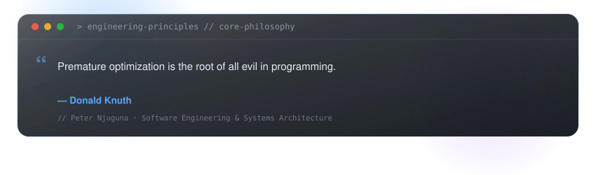

# Hi, I'm Peter 👋
### Software Engineer · Backend · Full-Stack · AI
**Nairobi, Kenya** • [Portfolio](https://iam-petero.vercel.app/) • [LinkedIn](https://www.linkedin.com/in/peter-njuguna-13b00a411) • [Email](mailto:chapokumih@gmail.com)

<div align="center">


<br>


</div>

<br>

## 01 — About Me

I build web applications, backend services, and data-driven systems with a strong focus on clean architecture, secure data handling, and maintainable code. My primary specialization is **backend engineering with Python and PostgreSQL**, complemented by the full-stack capability to design and ship responsive user interfaces.

* 🔭 **Currently focused on:** Backend engineering, high-performance REST APIs, database modeling, and system architecture.
* 🛠️ **Building with:** Python (FastAPI/Flask), TypeScript, Node.js, Express, React, Next.js, and SQL.
* 🗄️ **Databases:** PostgreSQL, MySQL, and MongoDB.
* 🤖 **Exploring & Applying:** Practical AI integration, LLM evaluation, and automated quality assurance pipelines.
* 🎯 **Goal:** Engineer reliable, production-ready systems and contribute to high-impact engineering teams.

<br>

<!-- DAILY-INSIGHT:START -->
<div align="center">

<a href="https://github.com/petero-codes/petero-codes">
  
</a>

</div>
<!-- DAILY-INSIGHT:END -->

<br>

## 02 — Technical Skills

Consistent skill ecosystem powered by [Skill Icons](https://github.com/tandpfun/skill-icons):

#### ⚡ Backend & Databases *(Primary Specialization)*
<p align="left">
  <a href="https://skillicons.dev">
    
  </a>
</p>

* **Core Backend:** Python, FastAPI, Flask, Node.js, Express.js, RESTful APIs, JWT Authentication, Role-Based Access Control (RBAC).
* **Databases & ORMs:** PostgreSQL, MySQL, MongoDB, SQLAlchemy, Alembic migrations, database indexing, and query optimization.

#### 🎨 Frontend & Web Development
<p align="left">
  <a href="https://skillicons.dev">
    
  </a>
</p>

* **UI & Client Architecture:** TypeScript, JavaScript (ES6+), React.js, Next.js, Tailwind CSS, Responsive Design, State Management.

#### 🛠️ DevOps, Infrastructure & Tools
<p align="left">
  <a href="https://skillicons.dev">
    
  </a>
</p>

* **Tooling:** Git, GitHub Actions (CI/CD), Linux CLI, Docker (Personal Architectures), Postman, VS Code, Vercel.

#### 🛡️ Quality, Security & Engineering Practices
* **Principles:** Strict Separation of Concerns, Server-Side Defensive Validation (Pydantic / Schemas).
* **Testing & QA:** `pytest`, HTTP testing, error handling, access control, and automated CI workflows.

<br>

## 03 — Featured Projects

### 1. [Seekon Sneakerverse](https://github.com/petero-codes) — Full-Stack E-Commerce Platform
> Complete sneaker and apparel discovery experience built for speed, catalog browsing, and seamless cart operations.
* **Tech Stack:** React.js · Node.js · Express.js · MongoDB / PostgreSQL · Tailwind CSS
* **Highlights:**
  * Dynamic catalog filtering by release date, brand, and pricing tiers.
  * Persistent shopping cart state and responsive storefront interface.
  * REST API endpoints designed for inventory retrieval and session management.
* [**View Source Code →**](https://github.com/petero-codes)

---

### 2. [Merygoround](https://github.com/petero-codes) — Rotating Savings & Contribution Engine
> Financial management platform designed for structured group savings (ROSCA) and automated contribution schedules.
* **Tech Stack:** React.js · Node.js · REST APIs · Relational Modeling
* **Highlights:**
  * Deterministic scheduling algorithms managing participant payout rotation cycles.
  * Audit logging and transaction history to verify group contribution compliance.
  * Transparent dashboards reflecting real-time member records and status.
* [**View Source Code →**](https://github.com/petero-codes)

---

### 3. [Production Backend & API Architecture](https://github.com/petero-codes)
> Demonstrating production-grade backend design patterns, secure data handling, and automated test pipelines.
* **Tech Stack:** Python · FastAPI · PostgreSQL · SQLAlchemy · Alembic · Docker
* **Highlights:**
  * Clean architectural boundaries: Router → Service Layer → Repository Pattern.
  * Strict defensive input validation using Pydantic schemas.
  * Stateless JWT authentication with granular permission scopes (RBAC).
  * Automated migration workflows with Alembic and comprehensive test suites via `pytest`.
* [**Explore Repositories →**](https://github.com/petero-codes)

---

### 4. [AI Evaluation & Automated Verification Framework](https://github.com/petero-codes)
> Structured quality assurance workflows for large language models, dataset integrity, and fact verification.
* **Tech Stack:** Python · LLM Assessment Frameworks · Data Validation
* **Highlights:**
  * Evaluated and ranked 1,000+ AI-generated responses for reasoning accuracy, instruction adherence, and safety.
  * Automated benchmark evaluation scripts to detect hallucination and measure response quality.
  * Standardized datasets for high-fidelity model alignment and fine-tuning pipelines.
* [**Explore AI Work →**](https://github.com/petero-codes)

<br>

## 04 — AI & Technical Evaluation

Unlike standard web developer profiles, I have dedicated experience in **AI training, evaluation, and quality assurance**:

```
  ┌────────────────────────────────────────────────────────────────────────┐
  │                     AI QUALITY ASSURANCE WORKFLOW                      │
  ├───────────────────────────────────┬────────────────────────────────────┤
  │ Model Reasoning Assessment        │ Logic, Coherence & Constraint Check│
  │ Fact Verification & Grounding     │ Hallucination & Source Attribution │
  │ Instruction Following             │ Adherence to Complex Multi-Prompts │
  │ Dataset Validation & Curation     │ Anomaly Detection & Normalization  │
  │ Automated Python Benchmarking     │ Custom Metric Evaluation Scripts   │
  └───────────────────────────────────┴────────────────────────────────────┘
```

* **1,000+ Model Output Evaluations:** Analyzed and ranked large language model responses across multi-step reasoning, mathematical problem-solving, code generation, and instruction-following tasks.
* **Dataset Quality & Safety Assurance:** Audited structured datasets for truthfulness, bias mitigation, and safety guidelines.
* **Workflow Automation with Python:** Created specialized Python scripts to automate format compliance checking, response diffing, and dataset batch verification.

<br>

## 05 — Development Velocity & GitHub Stats

<div align="center">


<br>


</div>

<br>

## 🐍 GitHub Contribution Snake

<div align="center">


</div>

<br>

## 06 — Currently Learning & Connect

```yaml
currently_learning_and_leveling_up:
  - Advanced Python & FastAPI asynchronous patterns
  - PostgreSQL query optimization, connection pooling & indexing
  - Docker containerization & microservices orchestration
  - Automated testing, CI/CD, and practical cloud deployments
```

<div align="center">

### Let's Connect & Collaborate

Whether you are looking for a **Software Engineer**, **Backend Specialist**, or need **Python / AI Evaluation** expertise:

[**Portfolio**](https://iam-petero.vercel.app/) •
[**GitHub**](https://github.com/petero-codes) •
[**LinkedIn**](https://www.linkedin.com/in/peter-njuguna-13b00a411) •
[**Email Me**](mailto:chapokumih@gmail.com)

<br>


</div>
